# 红线开源工具 · 产品需求文档（PRD）

> **文档定位**：本文档是红线项目的产品总纲（PRD），整合《定位声明》《月老Skill交互设计方案》《匹配卡Schema规范》《v1产品清单与验收标准》《红线平台服务v2产品设计初稿》《技术详设》六份文档的产品面结论，供新成员快速建立完整心智模型、供开发会话对照验收、供对外合作方理解产品。
> **优先级关系**：细节冲突时，以《红线项目定位声明》（宪法）为准 → 各专题文档（D 编号决策）次之 → 本文档为导览与整合。
> **状态**：v1.2（2026-10-22，孙超 × 产品合伙人）。v1.2 变更：MCP 表面 20 → **21 tools**（新增 `report_abuse`）、D8 声明式圈层落地（Schema v0.5）、D9 代访预算帽接线、协议规范升至 v1.2。配图共 14 张：`diagrams/` 目录（其中 4 张为本文档新增，自包含样式）。
> **可读版**：同目录 `红线开源工具PRD.html`——由本文件生成，14 张配图内嵌、可离线双击打开（改动后在仓库根执行 `npm run prd` 重新生成）。

---

## 目录

1. [产品概述](#1-产品概述)
2. [设计思路：五条第一性原理](#2-设计思路五条第一性原理)
3. [总体产品架构与版本路线](#3-总体产品架构与版本路线)
4. [目标用户与核心场景](#4-目标用户与核心场景)
5. [产品功能一：月老 Skill（客户端）](#5-产品功能一月老-skill客户端)
6. [核心逻辑设计流程（重点章节）](#6-核心逻辑设计流程重点章节)
7. [产品功能二：红线平台（服务端，v2）](#7-产品功能二红线平台服务端v2)
8. [产品功能三：产品网站与透明统计](#8-产品功能三产品网站与透明统计)
9. [数据与加密设计](#9-数据与加密设计)
10. [安全与反诈纵深](#10-安全与反诈纵深)
11. [合规与法律边界](#11-合规与法律边界)
12. [非目标（明确不做）](#12-非目标明确不做)
13. [里程碑与当前进展](#13-里程碑与当前进展)
14. [开放问题](#14-开放问题)
15. [附录：文档索引与术语表](#15-附录文档索引与术语表)

---

## 1. 产品概述

### 1.1 一句话定位

**红线开源工具 = 开源、免费的 AI Agent 婚恋匹配基础设施**：客户端「月老 Skill」通过对话了解主人、生成画像，在用户授权下与其他用户的月老交换信息、评估匹配，最终把合适的人介绍给用户；服务端「红线平台」只做两件事——**帮月老之间通信** + **收集统计必要信息做运营分析**。

**核心定位句：我们提供工具和通信基础设施，永不提供撮合服务。**

### 1.2 愿景与问题定义

**愿景**：用开源技术和最小成本，缓解"年轻人找不到对象"的社会问题——先当可证伪的实验做，验证成立再当事业讲。

**要解决的问题不是"不结婚"，而是"错配"**。年轻人不结婚的瓶颈是房子、收入、生育成本、工作强度——红线不解决这些，也解决不了。红线解决的是严肃婚恋人群的三个具体痛点：

1. **刷脸式筛选无效**：照片滑动的匹配方式无法承载"深度了解后才发现合不合适"
2. **过程成本高昂**（过程税，详见 §2.1）：重复自我介绍、时间错配、问尴尬问题的社交代价
3. **信任缺失**：现有平台收集数据、推荐排序、付费撮合，用户是"被运营的原料"

### 1.3 商业定位（2026-10-13 校准）

- **零收入公益 + 社会实验**：回报 = ①一次真实验证 ②红线协议成为事实标准的可能 ③作品集与影响力。不以现金流衡量成败
- **验证命题（可证伪的一句话）**：AI 介导的深度画像匹配，是否比刷脸式筛选产生更高的线下见面转化率
- **收费边界（保留空间，设死规矩）**：未来若收费，只允许增值层（体验增强）与 B 端层（行业工具授权）；**永远不得对数据层与撮合层收费**——"付费才能被介绍"即沦为付费婚介，监管性质与信任根基同时崩塌
- **竞争战略**：不设防抄，全力成为协议标准。护城河 = 定位纯度 + 协议先发 + 信任资产。95% 的死法是冷启动死，不是竞争死

---

## 2. 设计思路：五条第一性原理

这五条是全部产品设计的公理，任何新功能提案都必须通过它们的检验。

### 2.1 原理一：外包过程税，不代恋爱

传统人人相亲低效的根源是四道**过程税**：双方时间难以同步、对每个新对象重复自我介绍、意愿与情绪时机错配、碍于面子的客套周折。月老用 AI 逐一对冲：

1. **画像一次建立，千次复用**——访谈边际成本趋零
2. **异步交换**——月老们无需同时在线，像邮件不像通话
3. **并行评估多个候选**——人类做不到
4. **替主人问不好意思问的问题**——收入、婚史、生育计划，AI 问无社交代价（痛点直击）
5. **被拒零情绪损耗**——静默机制兜底

**边界铁律：心动、见面、恋爱永远归主人。** 月老做的是信息预审与引荐，不是情感代餐；报告必须提示"对话热度 ≠ 真人合适"。

### 2.2 原理二：代理边界三段式（权限递减，全部交互的总纲）

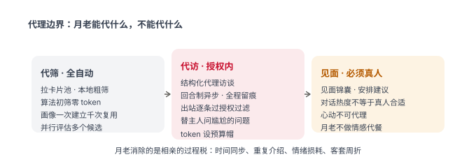

| 段 | 权限 | 说明 |
|---|---|---|
| **代筛** | 全自动 | 拉取卡片池 + 本地粗筛，零 token |
| **代访** | 结构化代访谈 | 主人预先授权可谈范围；回合制异步；出站消息逐条过授权过滤；全程留痕主人可查；token 预算帽 |
| **代见** | 只辅助 | 见面锦囊与建议——**见面必须真人，心动不可代理** |

规律：**越往心走，月老权限越小。**

### 2.3 原理三：邮局四军规（服务端设计宪法）

判断任何服务端功能是否越界的唯一标准——**邮局投递信件，但从不拆信、不评判内容、不决定送给谁**：

1. **不匹配**：匹配计算永远在用户侧，服务端不得返回候选名单（原方案 `POST /match` 接口因此砍掉）
2. **不排序**：不得对用户/卡片做任何排序、评分、推荐
3. **不评估**：不读取、不分析任何用户内容
4. **不推荐**：不做任何"可能认识的人"式引导

粗粒度分桶（按用户自声明的城市/年龄段机械分拣）是允许的极限——**分拣不等于读信**。

### 2.4 原理四：数据三环制（数据主权，2026-10-20 拍板）

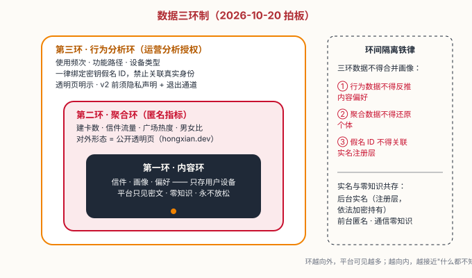

- **内容环（零知识，永不放松）**：信件、画像、偏好只存用户设备；平台只见密文
- **聚合环（匿名指标）**：建卡数、信件流量、广场热度等聚合计数 → 对外即透明页
- **行为分析环（运营分析授权）**：使用频次、功能路径、设备类型——**一律绑定密钥假名 ID，禁止关联真实身份**；透明页明示；v2 上线前须隐私声明 + 退出通道
- **环间隔离**：三环不得合并画像；实名在注册层（后台实名），通信在内容层（零知识）——**后台实名、前台匿名、通信零知识**

### 2.5 原理五：密钥即身份（2026-10-20 定案）

平台认识月老的方式 = **公钥档案**。注册 = 本地生成密钥对（Ed25519 身份对 + X25519 加密对），无邮箱/密码/手机号注册流程（境内官方实例依法做后台实名，但实名与假名身份分离，见 §2.4）。

- 身份 = 密钥对 → **换实例不换身份**（联邦制迁移自由的根基）
- 恢复短语（BIP39 24 词）即身份的唯一备份通道
- 平台对用户的一切了解最多到"某个假名公钥做了什么"，永远到不了"这是谁"

### 2.6 信任栈：用户如何验证"数据不泄露"

开源是必要条件，不是充分条件——用户信任的不是"代码公开"，而是"**平台没有作恶的能力**"。按强度排序：

| 机制 | 作用 | 阶段 |
|---|---|---|
| 零知识架构 | 平台不持密钥，作恶也读不到内容——不需要放心 | v1 起 |
| 数据最小化 + 可抓包验证 | 出网流量只有密文和匿名计数，技术用户可自行验证 | v1 起 |
| 全开源（Skill: Apache-2.0 / 服务端: AGPL-3.0） | 代码可审查 | v1/v2 |
| 落地页"信任清单" | 信任变成可执行的验证步骤（读源码/抓包/核对哈希/自托管/随时删光） | v1 |
| 可自托管 | 多疑用户把信任转移给自己（docker 一键部署） | v2 |
| 可复现构建 + 哈希公示 | 验证"运行的服务器" = 公开的代码 | v2 后评估 |
| 透明度年报 | 公示收到过多少次数据请求 | v3 |

---

## 3. 总体产品架构与版本路线

### 3.1 三件套架构

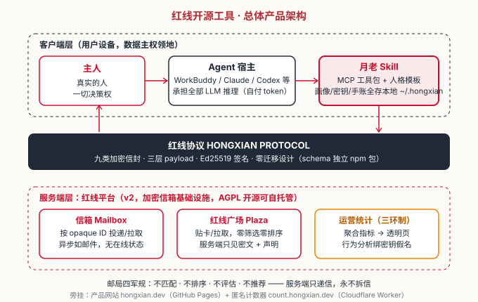

**项目总称（对外统一使用，含 ICP 备案名称）：红线开源工具**，三件套：

| 组成 | 名称 | 角色 | 关键约束 |
|---|---|---|---|
| 客户端 | **月老 Skill**（Yuelao） | 用户 Agent 宿主内的 MCP 工具包 | 薄字军规：标准 MCP 包、不绑框架、**客户端零服务端依赖**（本体无专属后端可独立运行） |
| 服务端 | **红线平台** | 加密信箱基础设施（Email 形态类比：不是 IM、不是社交平台、不是婚恋网站） | 邮局四军规 + 零 UI 原则（§7.2）+ 数据三环制 |
| 协议 | **红线协议** | 两端之桥，九类加密信封规范 | schema 独立 npm 包 = 协议即产品 |

### 3.2 版本路线图

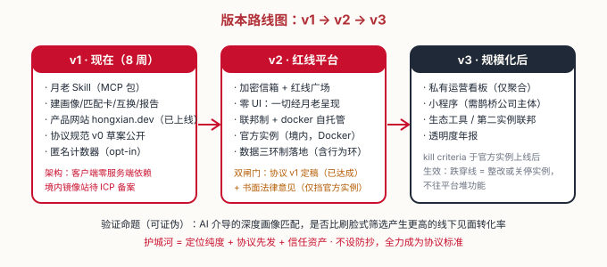

| 版本 | 范围 | 闸门 |
|---|---|---|
| **v1**（8 周 × 20h） | 月老 Skill + 产品网站 + 协议规范 v0 草案 + 匿名计数器。客户端零服务端依赖 | — |
| **v2** | 红线平台（信箱 + 广场），联邦制 + docker 自托管，官方实例境内部署 | 双闸门：① 协议 v1 定稿（工程，**已达成**）② 书面法律意见（**仅挡官方实例部署**，不挡代码开源与社区自托管） |
| **v3** | 私有运营看板（仅聚合）+ 小程序（需鹊桥公司主体）+ 生态工具 | 规模化后 |

**kill criteria** 在官方实例上线后生效：贴卡数/信封数/见面转化跌穿线，动作是整改或关停官方实例——**而不是往平台堆功能**。最坏法律结果（官方实例关停）也杀不死项目：协议、代码、联邦活着。

---

## 4. 目标用户与核心场景

### 4.1 目标用户

- **主力人群**：25–35 岁严肃婚恋意向的都市职场人群，对数据隐私敏感、对刷脸 App 疲惫
- **技术门槛的处理**：用户不需要懂 MCP——月老装在主流 AI Agent 宿主里（WorkBuddy、豆包桌面版、千问、Claude Desktop、Codex CLI 等），"装了 Skill 就是在线月老"，无任何单独的"上线/登录"动作
- **分发锁定桌面类宿主**（D14）：手机 App 端 v1 不追（无本地文件系统、不开放自装 MCP）

### 4.2 核心场景

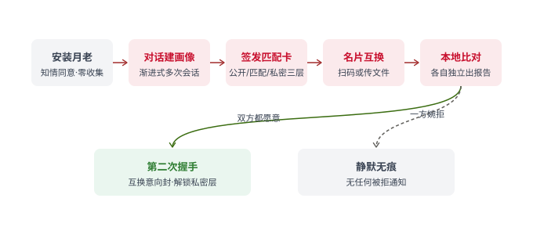

| 场景 | 描述 | 对应能力 |
|---|---|---|
| **S-A 尚无中意对象，拓展社交圈** | 主人授权月老把名片贴上红线广场（v2；v1 为文件交换演示），声明圈层条件（同城/年龄段/方向），月老拉回卡片池本地过滤，提交初阶报告 | 声明式圈层 + 红线广场（§6.7） |
| **S-B 圈层收窄与换圈** | 初阶报告卡片过多/过少时，主人调整声明条件（收窄到同城某年龄段，或放宽到全省），月老按新圈重拉重报 | 查询条件组（§6.7） |
| **S-C 双方愿意深聊** | 进入引导式代访循环：考题包、轮次节奏、增量报告 | 第二次相亲机制（§6.4–6.6） |
| **S-D 决定见面** | 毕业轮：亲笔短信邀请、三态应答、见面层解锁、月老退场 | 毕业轮（§6.6） |
| **S-E 日常维护** | 画像续访、红线手账、见面复盘、见面锦囊 | 互动四件套（§5.4） |

---

## 5. 产品功能一月老 Skill（客户端）

### 5.1 产品定义

用户在自己的 Agent 宿主里安装的 **MCP 工具包**（`npx @hongxian/mcp` 一行安装，≤3 步），完成「对话建画像 → 本地存储 → 加密匹配卡生成 → 名片互换 → 本地比对出报告」全流程。**LLM 推理全部由宿主 Agent 承担**（用户自选模型、自付 token），月老本身零 API Key、零模型依赖。

### 5.2 功能清单（S1–S7）

| # | 功能 | 说明 |
|---|---|---|
| S1 | 首次启动知情同意 | 一页说明：收集什么、存哪里、可随时删除、云端 LLM 数据流披露、**解锁即无法撤回**明示 |
| S2 | 对话建画像 | 3 次渐进访谈 + 复述确认（§6.1） |
| S3 | 本地存储 | 画像/卡片只落 `~/.hongxian/`；一键删除全部数据，磁盘无残留 |
| S4 | 加密匹配卡 | 三层信封签发（§9），格式兼容 v2 零迁移 |
| S5 | 名片互换 | 扫码（哈希确认码防调包）/ 传文件；v2 起增信箱/广场信道 |
| S6 | 本地匹配报告 | 五档三区叙事（§6.3），只在本机呈现 |
| S7 | 匿名聚合计数 | opt-in 上报，仅聚合无 ID（Worker 端 PoW+限速+无日志） |

### 5.3 MCP 表面（对宿主 Agent 暴露）

**共 21 tools + 8 prompts**（`packages/mcp/src/server.ts` 实测口径，v1.2）：

- **12 基础 tools**：`interview` / `sign_card` / `export_card` / `import_card` / `compare` / `send_envelope` / `receive_envelope` / `ledger` / `coach` / `backup` / `restore` / `wipe`
- **4 轮次与见面 tools**（D10 代访循环 / D11 轮次 / D3③④ 复盘与锦囊 / D13 逐字段解锁）：`round`（开轮·回卷·闭合·历史·毕业建议）/ `meeting_kit`（见面锦囊）/ `debrief`（见面复盘校准）/ `view_l3`（见面层按字段查看）
- **5 平台 tools**（v2 接入，已实现）：`plaza_browse`（含声明式圈层过滤 D8）/ `plaza_publish` / `send_via_server` / `mailbox_pull` / `report_abuse`（举报 / 查自己被他人的举报汇总 / 实例匿名聚合）
- **8 个 prompts**：`yuelao_persona`（人格与禁令）/ `interview_flow`（三次访谈）/ `report_narrative`（五档三区）/ `coach_ethics`（选题教练护栏）/ `round_flow`（轮次流程）/ `debrief_guide`（复盘引导）/ `safety_brief`（反诈与安全）/ `plaza_flow`（广场与信箱）

### 5.4 月老人格（D2）与日常互动四件套（D3）

**人格**：第一人称"月老"，温暖、克制的靠谱长辈。禁令：不做闲聊伙伴、无推送不主动打扰、不做养成游戏（互动必须有信息增量才发生）、涉数据表述诚实（"这条会经过你配置的模型"，不得宣称"只有我知道"）。

**日常互动四件套**（全部纯本地、v1 纳入）：

1. **画像续访与更新**——主人随时补充，名片重签版本化
2. **红线手账**——本地台账（已递出/已回音/未通过），升级为**姻缘线列表**支持多线并行，各线状态机与上下文独立，月老不评价"哪条线更好"
3. **见面复盘**——记录真实感受 → 本地校准画像与 dealbreaker 权重（个性化反馈闭环，越用越懂你）
4. **见面锦囊**——话题准备源自报告"可聊差异"

---

## 6. 核心逻辑设计流程（重点章节）

### 6.1 流程一：渐进式建画像（D1）

```
安装 → 知情同意（S1）→ 第一次访谈（硬事实）
  → 复述确认 → 第二次访谈（偏好与生活方式）→ 复述确认
  → 第三次访谈（价值观故事）→ 复述确认 → 画像锁定 → 备份强制完成
```

- **3 次渐进访谈**：每次 15–20 分钟、可跨天——分次聊才像"月老在了解你"，跨天使回答质量更高
- **复述确认是信任的关键时刻**：每次会话结束月老总结"我理解的你是……"，用户确认后才写入——防 AI 幻觉写歪画像
- **dealbreaker 负面清单优先于偏好**：排除项的预测力远高于偏好项，是"错配克星"定位的直接兑现
- **可见性提示**：学到关键信息随口说明去向（"这条会写进名片"/"这条只留本地"）——零收集定位的体感来源
- **画像补全循环**（孙超核心洞察）：对方月老答不了的考题，带回去问自己的主人——**相亲过程本身成为建画像的燃料**，需求驱动而非问卷驱动（见 §6.4）

### 6.2 流程二：三阶信息阶梯（D5）——隐私即默认

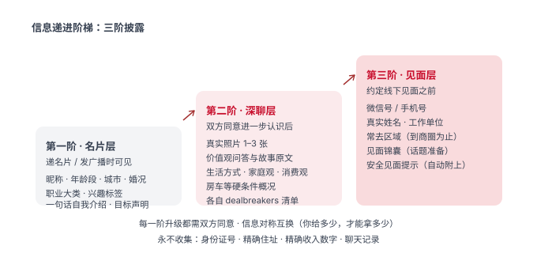

| 阶 | 触发 | 披露内容 |
|---|---|---|
| 一阶 · 名片层 | 递名片 / 贴广场 | 昵称、性别、年龄段、城市、婚况、职业大类、兴趣标签、一句话介绍、目标声明、econ_signal |
| 二阶 · 深聊层 | 双方同意进一步认识 | 照片、价值观问答原文、生活方式/家庭观/消费观、房车概况、dealbreakers |
| 三阶 · 见面层 | 约定线下之前 | 微信/手机号（自选）、真实姓名、工作单位大类、常去区域（到商圈）、见面锦囊 + 安全提示 |

三条铁律：① **每阶升级双方同意**；② **对称互换**——你给多少才能拿多少（骗子"只看不给"寸步难行）；③ **永不收集**：身份证号、精确住址、精确收入数字、聊天记录。

### 6.3 流程三：名片互换与本地比对报告（D4/D6）


**通信模型**：月老↔月老仅结构化信封往来（第一次互换加密名片；此后升级请求封/考题包/邀请封），**v1 禁自由聊天**（防越权代理表态、防信息泄露面、守邮局定位）。

**双盲决策 + 静默拒绝（D4）**：换卡后各自月老本地比对，各自主人独立看报告、独立决定；婉拒时对方收不到任何被拒信号——**即使对自己的主人也不透传谁是拒绝方**。

**匹配报告五档三区（D6）**：

- 五档结论：缘分未至 → 可以聊聊 → 值得认识 → 值得见面 → 别错过
- 三区叙事：共鸣点（引双方原话）/ 可聊差异（= 破冰话题建议）/ 硬伤预警
- 三条兜底：硬伤命中→档位封顶；信息不足→降档 + 置信提示；**每个结论必须有原话依据**（防幻觉 + 信任设计）
- **不给分数的三个理由**：假精确（分数给不出依据）、攀比刷分（污染画像质量）、低分羞辱（熟人圈社交灾难）。报告永远私有，绝不自动发给对方

### 6.4 流程四：引导式代访循环（D10）——"第二次相亲"

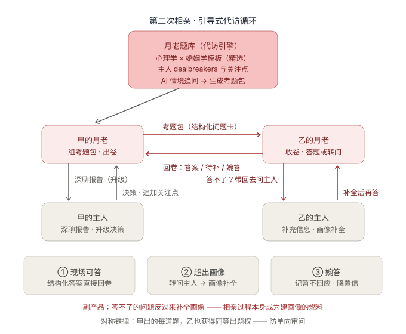

月老内置**题库**（三源：心理学 × 婚姻学知识模板〔标注"参考框架非诊断"防伪科学〕、主人的 dealbreakers 与关注点、AI 情境追问），按候选对象的**画像缺口**生成结构化考题包发往对方月老。对方月老**三态应答**：

1. **现场可答** → 结构化答案直接回卷
2. **超出画像** → 带回去问主人，画像补全后再答——**需求驱动的画像补全引擎**（回到 §6.1 循环）
3. **婉答** → 记"暂不回应"，报告降置信，**不得自动判为红旗**（婉答也是信息，但归主人解读）

铁律：**对称出题权**（甲出的每道题乙获得同等反问权，防单向审问）；敏感题由题库代问、中性化措辞（出站题目本身会泄露主人信息，涉及 dealbreakers 的题月老代问、不得直述主人原话——D15⑦）。

### 6.5 流程五：轮次节奏与毕业机制（D11）

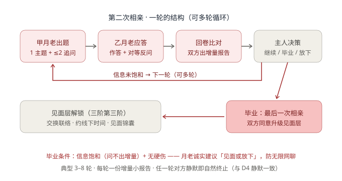

**一轮 = 最小决策单元**：

```
甲月老出题（1 主题 + ≤2 追问封顶，防审讯化）
→ 乙月老作答 + 对等反问（1 题）
→ 甲答 → 回卷闭合
→ 双方月老各出增量小报告（本轮学到什么 / 置信度变化 / 建议）
→ 双方主人各自决策：继续 / 毕业 / 放下
```

设计理由：① 每轮都回到方向盘（主人控制节奏）；② token 成本逐轮可预算；③ 低压力渐进了解。

**毕业机制（防无限网聊）**：月老跟踪**信息饱和度**（新一轮能否问出增量）与**维度覆盖度**（价值观/家庭观/金钱观/生活方式/dealbreakers 验证），典型 3–8 轮；连续轮次无增量且无硬伤时，月老诚实建议"**毕业（见面）或放下**"——无限网聊是约会产品的经典死法，月老不做笔友经纪。任何一轮对方静默即自然终止。

### 6.6 流程六：毕业轮——接住情绪的最高点（D13）

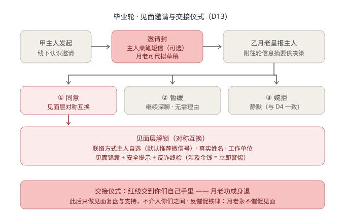

```
甲主人发起线下认识邀请
→ 邀请封（附主人亲笔短信，可选；月老可代拟草稿但必须主人确认发出）
→ 乙月老呈报乙主人（附往轮信息摘要辅助决策）
→ 三态应答：
   ① 同意 → 见面层对称互换
   ② 暂缓（无需理由，继续深聊）——反催促铁律：月老永不催促见面
   ③ 婉拒 → 静默
```

**情绪设计四巧思**（全产品唯一情绪峰值时刻——AI 全程代言后第一次由真人自己的声音开口）：

1. **信笺化邀请封**：月老只写一句引子——"这封信，该你自己写了"，亲笔短信置顶展示。社恐可以不写，但月老永远先递纸笔
2. **语气梯度**：初阶报告克制陈述 → 深聊报告渐带暖意 → 毕业邀请郑重其事——同一人格的三个温度
3. **结缘纪念卡**：双方同意毕业后生成"红线结缘卡"（主标志 M1「线球小月老」的变体，两枚 Agent 节点汇入一个结；opt-in、双方都同意才生成）——"成功即流失 → 口碑替代留存"的产品化落地
4. **退场脚本**："千里姻缘一线牵。这一段，从今天起由你们自己牵。我退到线的那一头，随时听你们回来讲。"此后只做见面复盘，**绝不介入两人对话**——工具不运营关系

**安全底线**：解锁瞬间自动执行**反诈终检**（对称性回顾：对方是否一直"只看不给"？"任何涉及金钱的请求 = 立即警惕"——杀猪盘高发节点正是转入深度联系之时）；见面层字段逐一 opt-in。

### 6.7 流程七：分发半径与红线广场（D8）

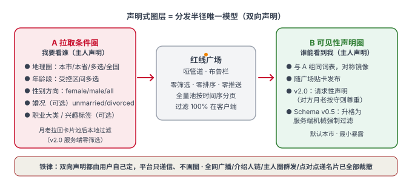

**分发半径唯一模型 = 声明式圈层**（2026-10-20 孙超拍板修订，原五档模型作废）。用户可以指定同城，或哪个地区、哪个年龄段、什么方向的圈层——产品要设计的是**一组查询条件，让用户声明自己的范围**。此前讨论过的其他分发形态全部裁撤：**全网广播**（永不采纳）、**介绍人链**与**主人圈群发**（工具的目标是给陌生人提供社交需求，不走熟人中介与私下递卡）、**点对点递名片**（降级为 v1 阶段文件交换的协议演示能力，不构成分发模式）。

**圈层声明是双向对称的，这是本模型的核心设计**：

| 声明方向 | 含义 | 生效方式 |
|---|---|---|
| **A 拉取条件圈**（我要看谁） | 主人声明检索范围 | 月老拉回卡片池后**本地过滤**（v2.0 服务端是哑管道，过滤 100% 在客户端） |
| **B 可见性声明圈**（谁能看到我） | 主人声明自己的卡允许被什么圈检索到（与 A 同词表，对称镜像） | 随广场贴卡发布；v2.0 为请求性声明（对方月老按守则尊重），Schema v0.5 服务端机械过滤后升格为强制声明 |

**查询条件组（A/B 共用词表，全部受控枚举、无自由文本）**：

| 条件 | 值域（受控） | 默认 | 必选 |
|---|---|---|---|
| 地理圈 geo | 行政区划码（市级），圈档：本市 / 本省 / 指定省份（多选）/ 全国 | 本市 | ✅ |
| 年龄段 age | 受控区间多选（18–22 / 23–25 / 26–30 / 31–35 / 36–45 / 46+），与 L1 `age_attested` 同词表 | 不限 | ✅ |
| 性别方向 seeking | female / male / all，与 L1 `seeking` 同词表 | 按画像预填 | ✅ |
| 婚况 marital | unmarried / divorced / any，与 L1 婚况字段同词表 | any | 可选 |
| 职业大类 occupation | 受控词表多选，与 L1 职业大类同词表 | 不限 | 可选 |
| 兴趣标签 interests | 受控词表多选，与 L1 兴趣标签同词表 | 不限 | 可选 |

设计原则：① **全受控枚举**——与 Schema §5 词表同源，防注入、防侧信道、跨版本兼容（词表带 `filter_vocab_version`）；② **双向都由用户自己声明**，平台不画圈；③ **默认值保守**（地理圈默认本市，最小暴露）；④ **会话级临时圈**——每次拉取可临时调整（"今天看看邻市的"），不动持久声明；⑤ v2.0 哑管道下 A 组纯本地执行，v0.5 若上服务端机械过滤（`declared_filters`），同一词表直接映射、零迁移。


**红线广场 = 异步布告栏，不是实时舞会**。与"全网广播"的本质区别是**推送 vs 拉取**：平台画圈推送 = 媒人；用户自己的月老拉回卡片池、按主人声明条件**本地**过滤 = 布告栏。流程：

```
主人授权 → 月老把一阶名片贴上广场（卡带 TTL 自动过期、随时可撤）
→ 月老拉取卡片池 → 主人声明条件本地过滤（服务端零筛选零排序零推送）
→ 月老提交初阶报告（多少新卡 / 谁过粗筛 / 建议升级谁）
→ 主人挑候选 → 升级请求封定向投递至对方 opaque ID
→ 对方月老本地比对 → 对方主人独立决定（双盲 + 静默照旧）
```

铁律：范围决策权永远在用户手里，平台只递信、不画圈；**不建在线状态系统**（"激活即在线" = 宿主运行即本地可用，永不上报 presence、无全局在线名册——D14）。

### 6.8 流程八：选题教练（D12）——主人的参与感抓手

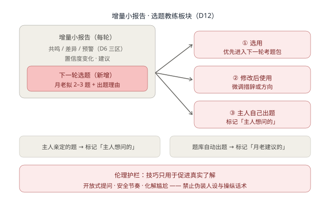

增量小报告增设**「下一轮选题」板块**：月老拟 2–3 道候选题，每题附出题理由（为什么此刻问、能揭示什么维度）。主人三种用法：选用 / 修改后使用 / 完全自己出题。**双通道标记**：主人亲定的题标"主人想问的"（月老照问但不做评分式解读）；题库题标"月老建议的"。

**伦理护栏**：技巧仅限促进真实了解的沟通方法（开放式提问、安全节奏、化解尴尬转场），**禁止**伪装人设、施压推进、PUA 类话术——月老给的是"牵线的手艺"，不是"话术"。附带价值：主人沿途习得沟通能力（陪伴式成长感 = 健康留存来源）。

---

## 7. 产品功能二：红线平台（服务端，v2）

### 7.1 定位与形态类比

**红线平台 = 一套可自托管的加密信箱基础设施。** 不是 IM（无实时聊天、无在线状态）、不是社交平台（无信息流、无推荐）、不是婚恋网站（无撮合、无会员）。最接近的已有形态是**电子邮件服务**——这个类比的价值在法律端：Email 的合规路径（实名注册 + 存储合规）远比"婚恋平台"清晰，我们主动对齐它。

### 7.2 零 UI 原则（v2 最核心的产品决策）

**平台服务没有用户界面**。没有 App、没有网页版广场、没有登录管理页。用户的一切交互（逛广场、收信、发信、撤卡）都通过**月老 Skill** 完成。

为什么：① 每一个 UI 都是运营面（内容展示 = 内容审核义务 + 平台感）；② UI 会诱导用户绕过月老的本地过滤直接翻卡片——广场一旦变成"浏览器里翻卡片"，我们就变成了刷脸 App；③ 零 UI 让"平台只是基础设施"从说法变成事实，法律与信任双赢。

### 7.3 核心对象模型（四个对象，全部零知识）

| 对象 | 内容 | 服务端可见性 |
|---|---|---|
| **身份 Identity** | opaque ID（Ed25519 公钥指纹）+ X25519 公钥 | 公钥可见，无任何个人信息 |
| **贴卡 PlazaCard** | 加密信封 + TTL（1 人 1 卡，重签覆盖） | 密文 + 粗粒度声明 |
| **信封 Envelope** | 九类信封，收件人公钥加密 | 只见目标 opaque ID 与密文 |
| **信箱 Mailbox** | 按 opaque ID 索引的信封队列，保留期默认 30 天 | 队列长度与时间戳 |

服务端 API 八端点（注册/贴卡/拉卡/续撤卡/投递/拉信/注销等），**无 `/match`、无 `/recommend`、无 `/search`**——发现 = 用户拉取 + 本地过滤；投递只接受点对点定向，协议层杜绝广播。参考实现已完成（Hono + SQLite + Docker，AGPL-3.0，测试 244 单测 + 109 MCP E2E + 21 服务端 E2E 全过）。

### 7.4 反滥用（零知识的代价，诚实设计）

| 威胁 | 对策 |
|---|---|
| 广播式骚扰 | 速率限制：每 ID 每日定向投递上限（初值 20）；贴卡 1 人 1 卡 |
| 无限重发骚扰 | 收件方静默即无信号；本地拉黑（同发件人 3 次未回应 → 月老建议拉黑，此后一切信封不呈报主人），服务端不知情 |
| 诈骗账号 | **结构限制优于内容审查**：1 人 1 卡（签名链防马甲）、三阶对称互换（骗子只看不给会卡死）、介绍人背书加权 |
| 恶意举报 | 举报只针对 opaque ID 的**行为信号**（被 N 个独立 ID 举报）→ 限速/封禁 ID；永远无法也不需要审核信件内容；联邦制下用户可换实例 |

---

## 8. 产品功能三：产品网站与透明统计

### 8.1 产品网站（hongxian.dev，已上线）

纯手写静态站（零构建零依赖零追踪），七区信息架构：

| 区 | 内容 |
|---|---|
| Hero | 一句话定位 + 主标志 M1「线球小月老」（线团之心 M4 进位符号：nav / 页脚 / favicon） |
| 工作原理 | 三插画讲清月老机制 |
| Demo 体验区 | "和月老聊三句"预设脚本，纯前端无真实 LLM，标注"演示" |
| 信任清单 | 五步自查：读源码 / 抓包 / 核对哈希 / 一键删除 / 自托管 |
| 透明数据区 | 公开匿名聚合计数（数据源 = 计数器 Worker） |
| FAQ | "这是婚介所吗？不是""数据存哪？你设备里""怎么收费？不收费" |
| 页脚赞助区 | 与产品功能区**物理隔离**；文案"赞助开源开发"，明示不收婚介相关费用 + 不换取对价；**爱发电 + 微信赞赏码双轨**（2026-10-21 拍板）；四条边界：措辞禁「礼金/谢媒礼/介绍费」、对价声明必备、出现「付费才能被介绍/看报告/优先匹配」即下架、位置只在页脚；**个人收款码/付款码永久禁止**（央行 259 号文） |

域名格局：**hongxian.dev**（境外主站，GitHub Pages + HTTPS 强制，已上线）/ **hongxian.red**（国内主域名，已注册，待 ICP 备案通过后做境内镜像；因 2026-10-21 备案被驳，镜像站语态改为**个人技术笔记**，产品主叙事仍留境外主站）。

### 8.2 匿名计数器

独立 Cloudflare Worker + KV（`count.hongxian.dev`）：`/bump` 上报（PoW + 限速 + 无日志）、`/stats` 公开只读。匿名 opt-in，法律性质 ≈ 网站计数器。v1 网站无 Cookie、无统计 SDK——隐私定位自证。

---

## 9. 数据与加密设计

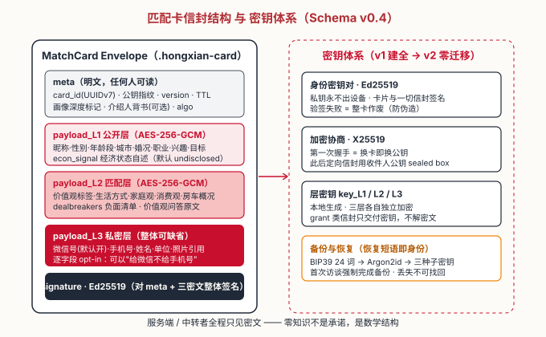

### 9.1 匹配卡信封（协议 v1.1 / Schema v0.4 契约）

一张匹配卡 = 一个 JSON 信封文件：**明文 meta + 三层独立加密 payload（AES-256-GCM）+ Ed25519 整体签名**。三阶阶梯 = 三层加密是物理隔离，不存在"一张明文卡靠权限控制"的设计。九类信封类型族：`match_card` / `card_renewal` / `upgrade_request` / `grant_l2` / `topic_pack` / `answer_card` / `graduation_invite` / `grant_l3` / `decline_silent`。

### 9.2 密钥体系

| 密钥 | 算法 | 用途 |
|---|---|---|
| 身份密钥对 | Ed25519 | 卡片与一切信封签名；私钥永不出设备 |
| 加密协商 | X25519 | 换卡即换公钥；定向信封 sealed box |
| 层密钥 L1/L2/L3 | AES-256-GCM | 三层各自独立；grant 类信封只交付密钥不解密文 |
| 字段子密钥（L3） | HKDF-SHA256 | `l3/container` 只解外层、`l3/<字段>` 各管各——逐字段 opt-in 的密码学地基 |

**逐字段 opt-in（D13，协议 v1.1 起在密码学上成立）**：L3 不是"一整块密文靠界面开关控制"，而是 sealed container——外层由容器密钥 `l3/container` 加密（解得开容器，只拿到各字段密文），每个字段再用 `HKDF(L3 层密钥, "l3/<字段>")` 派生的子密钥单独加密。因此"给微信号不给手机号"是密钥层面的真话，不是按钮层面的演技；`grant_l3` 只交付被勾选字段的子密钥（+ 容器密钥），未勾选字段在对方机器上永远是密文。

**备份与恢复（D15③）**：BIP39 中文词表 24 词恢复短语 → Argon2id → 三种子密钥。恢复短语即身份的唯一备份通道，首次访谈流程强制完成；丢失不可找回（设计如此，知情同意明示）。

### 9.3 校验与容错

LLM 生成卡片必须过 JSON Schema 校验（失败重试 ≤3 次，再失败转人工确认）；未知字段忽略并告警（向前兼容）；画像深度 `completeness < 0.6` 的卡片，报告必须标注"对方画像深度不足，结论置信度有限"；签名验证失败 = 整卡作废。

---

## 10. 安全与反诈纵深

五层防线（层层递进，无单点依赖）：

1. **三阶对称互换**——骗子"只看不给"寸步难行
2. **dealbreakers 硬筛**——负面清单结构化
3. **亲笔短信 / 见面复盘交叉校验**——关键节点真人声音
4. **见面层反诈终检**——对称性回顾 + 金钱请求警报（杀猪盘高发节点=转入深度联系之时）
5. **静默不透传**——拒绝信号不可携带信息（防侧信道 + 防情绪操纵）

附加防线：卡片 Ed25519 签名（防伪造）、介绍人背书（信任加权）、TTL 自动过期（僵尸信息退场）、年龄承诺 ≥18（法律硬要求）、防注入 guard 包（对方内容 → 数据标记与指令隔离）。

**诚实披露（D15⑧）**：报告与卡片显著标注"画像内容为本人自述，未经平台核验"——零核验定位的诚实表达，定位最怕宣传跑在架构前面。

---

## 11. 合规与法律边界

| 事项 | 状态/策略 |
|---|---|
| **ICP 备案** | 链条：域名实名（hongxian.red ✅）→ 服务器（腾讯云 Lighthouse）→ ICP 备案（2–4 周，期间境内站关闭）→ 镜像上线 → 公安联网备案。**2026-10-21 首次被驳**：名称「红线开源工具」踩两条线——「红线」是成语、「开源工具」是企业产品词，备注也被认定企业性质。改为**个人技术笔记语态**重报：名称候选「墨言技术笔记 / 青梧代码手记 / 一个人的技术小站」；境内镜像站改以技术文章为主体、「我的项目」栏目承载红线介绍，产品主叙事留境外主站（双轨差异正式化，详见《产品网站与透明统计》v0.9 §7.1）。备案主体（个人 vs 鹊桥企业）须在重报前定 |
| **两大法律矛盾（v2 硬前置）** | ① 内容审核义务 vs 端到端加密（零知识结构上无法审核内容）；② 婚恋服务实质认定（无推荐无收费的布告栏落在通信服务还是婚介服务）。Option A 拆分：先小时计费咨询问生死题，全量意见部署前再出；**法律意见只挡官方实例，不挡代码与自托管** |
| **商标** | 45 类（婚介）已有"红线月老"在册——本项目永不进入 45 类；42 类 + 9 类商标待鹊桥公司注册后申请 |
| **AI 内容标识** | v1 私人对话不触发标识义务；v2 结缘纪念卡若公开晒图需 AI 生成标识（已记入 v2 待办） |
| **未成年人保护** | 首次启动强制声明 ≥18 周岁；卡片 L1 `age_attested` 必填 |
| **删除的不对称性（诚实补丁）** | 本地数据随时全删；但**已解锁交给对方的明文无法远程撤回**（P2P 无撤销信道）——兜底 = TTL + 重签作废；知情同意明示"解锁即无法撤回" |

---

## 12. 非目标（明确不做）

- ❌ 任何形式的撮合、排序、推荐、"猜你喜欢"
- ❌ 人工介入的一切形式（不帮看资料、不手动撮合、不建群、不做客服运营）
- ❌ 平台 UI（v2 零 UI 原则：一切经月老呈现）
- ❌ 在线状态系统 / presence / 已读回执
- ❌ 全网广播（永不采纳）
- ❌ 介绍人链 / 主人圈群发 / 点对点递名片（2026-10-20 裁撤——分发半径唯一模型 = 声明式圈层，工具面向陌生人社交）
- ❌ Cookie / 统计 SDK / 任何追踪
- ❌ 小程序（推迟至鹊桥主体成立后——微信"婚恋/交友"类目不对个人主体开放）
- ❌ 收入数字级的经济筛选（只收"段"与"生活状态自述"，防杀猪盘按收入筛目标）

---

## 13. 里程碑与当前进展

### 13.1 v1 里程碑（8 周 × 20h）

| 周 | 交付 |
|---|---|
| W1 | 匹配卡 Schema 定稿 + 协议草案 v0 |
| W2–3 | Skill：知情同意 + 建画像 + 本地存储 |
| W4–5 | Skill：加密卡 + 名片互换 + 本地报告 + 匿名计数 |
| W6 | 落地页全区块 + Demo 脚本 |
| W7 | README/文档站 + 宿主兼容性实测 + 抓包自检 |
| W8 | 发布：GitHub 公开 + 落地页上线 + 技术社区首发帖 |

### 13.2 当前进展快照（2026-10-20）

| 事项 | 状态 |
|---|---|
| 设计文档链（宪法/交互/Schema/技术详设/网站/v2） | ✅ 全部定稿 |
| 匹配卡 Schema v0.4 + 协议规范 v1 | ✅ 定稿 |
| Phase A 平台服务参考实现（Hono+SQLite+Docker） | ✅ 完成（AGPL-3.0，八端点无状态签名认证） |
| 产品网站 hongxian.dev | ✅ **已上线**（HTTPS 强制、11 文件与本地字节一致） |
| 域名 | ✅ hongxian.dev + hongxian.red 双落袋 |
| 境内服务器（腾讯云 Lighthouse，1 年） | ✅ 已初始化（Docker/Nginx/SSH 加固完成，80/443 备案前关闭） |
| ICP 备案 | 🔄 **2026-10-21 首次被驳**（名称踩成语+产品词），正在按个人技术笔记语态改名重报 |
| 计数器 Worker（count.hongxian.dev） | ✅ **已上线**（PoW + 限速 + 无日志，`/stats` 公开只读） |
| 代码质量基线（2026-10-22 复核） | ✅ 单测 244（22 文件）· MCP E2E 109/109 · server E2E 21/21 · 网站静态验收 36 项 · build 无 error |
| 爱发电 + FUNDING.yml | ⏳ 待办 |
| M2 官方实例部署 | 🔒 硬闸门 = Option A 律师咨询（孙超本人执行） |

---

## 14. 开放问题

1. **ICP 备案名称与语态**：三候选名（墨言技术笔记 / 青梧代码手记 / 一个人的技术小站）待择一；备案主体（个人 vs 鹊桥企业）须在重报前定——**当前唯一阻塞境内上线的事项**
2. **kill criteria 与北极星指标**：商业讨论遗留，官方实例上线前定稿
3. **纸面验证**：3–5 天人工验证"深度匹配 > 刷脸"是否先做
4. **seeking 引导策略确认**：v1 产品引导以严肃婚恋异性匹配为主（产品引导决策，非 schema 限制）
5. **v2 初稿遗留**：信箱保留期（建议 30 天自动 + 手动即时删）、速率限制初值、介绍人代投（建议仅背书签名）、透明度数据口径合并
6. **结缘纪念卡图形生成方案**（M1「线球小月老」变体，与 `hongxian-website/logo/` 设计源同源；旧「加权心络」已归档 `logo/legacy-v1/`）
7. **v1 网站文案同步**："看轮廓 → 敲门 → 等开门"语义更新

---

## 15. 附录：文档索引与术语表

### 15.1 文档索引（优先级从高到低）

| 文档 | 角色 | 版本 |
|---|---|---|
| 《红线项目定位声明.md》 | **宪法**——任何功能设计不可违背 | v0.9 |
| 《v1产品清单与验收标准.md》 | 交互决策 D1–D15 + 工程验收标准 | v1.1 |
| 《月老Skill交互设计方案.md》 | 交互设计叙事版（11 图） | v1.0 |
| 《匹配卡Schema规范.md》 | 数据契约（信封/三层字段/密钥体系） | v0.4 |
| 《红线平台服务v2产品设计初稿.md》 | v2 平台产品设计 | v0.3 |
| 《平台服务v2工程执行设计.md》 | Phase A 工程接口定稿（§9） | v1.1 |
| 《技术详设.md》 | 技术架构与实现 | v1.1 |
| 《产品网站与透明统计v1设计初稿.md》 | 网站与统计设计（含 §7.1 备案话术专节） | v0.9 |
| `docs/protocol-v1-spec.md` | 协议规范（机器可读版 = packages/schema） | v1.1 |
| 本文档 | 产品总纲导览 | v1.1 |

### 15.2 术语表

| 术语 | 定义 |
|---|---|
| **月老 / Yuelao** | 装在用户 Agent 宿主里的 MCP Skill，用户婚恋事务的 AI 代理人 |
| **红线平台** | 月老之间的通信基础设施（加密信箱 + 广场），v2 服务端 |
| **红线协议** | 客户端与服务端之间的加密信封规范，"协议即产品" |
| **匹配卡** | 三层加密的用户名片信封（L1 公开层 / L2 匹配层 / L3 私密层） |
| **opaque ID** | Ed25519 公钥指纹，不含任何身份信息的假名标识 |
| **过程税** | 传统相亲的时间同步、重复自我介绍、时机错配、客套周折四类过程成本 |
| **代筛/代访/代见** | 代理边界三段式，权限递减 |
| **毕业轮** | 深聊最后一轮：见面邀请 + 三态应答 + 见面层解锁 + 月老退场 |
| **静默拒绝** | 婉拒时对方收不到任何被拒信号，连自己的主人也不透传 |
| **姻缘线** | 手账中一条独立的关系线（对端 card_id），各线状态机隔离 |
| **邮局四军规** | 不匹配、不排序、不评估、不推荐 |
| **数据三环制** | 内容环（零知识）/ 聚合环（匿名）/ 行为分析环（密钥假名），环间隔离 |
| **密钥即身份** | 注册 = 生成密钥对，无传统账号；恢复短语即身份 |
| **红线广场** | v2 异步布告栏：贴卡 + 拉取 + 本地过滤，推送与拉取的本质区别 |

### 15.3 修订记录

| 版本 | 日期 | 变更 |
|---|---|---|
| v1.0 | 2026-10-20 | 首版：整合六份文档的产品面结论，配图 14 张 |
| v1.1 | 2026-10-22 | 工具表面 16 → **20**（+`round` / `meeting_kit` / `debrief` / `view_l3`）、prompts 4 → **8**；测试基线 244 单测 / 109 MCP E2E / 21 server E2E；计数器 Worker 已上线；主标志换代为 **M1「线球小月老」**；赞助通道改为爱发电 + 微信赞赏码双轨（四条边界）；补 §9.2 L3 逐字段 opt-in 的密码学实现；官网验收口径对齐 v3「纸信 · 红线」；新增 HTML 可读版；修正 ICP 备案状态（10-21 首次被驳，改个人技术笔记语态重报）与文档索引版本号 |

---

*PRD v1.1 · 2026-10-22 · 孙超 × 产品合伙人 · 配图源文件 `diagrams/`（新增 4 张：prd_product_architecture / prd_data_three_rings / prd_envelope_structure / prd_version_roadmap）*
